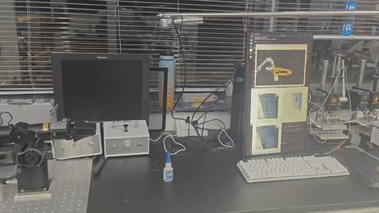

Real Piper GraspNet



本项目将 Intel RealSense D435i 的 RGB-D 数据送入 GraspNet，生成 6D 抓取候选，再由 Piper 机械臂执行候选预检和抓取动作。本文以当前源码为准，面向数据流理解、环境搭建、快速启动和真机联调。

完整的历史实验与问题调查见 [`docs/PROJECT_ARCHITECTURE_AND_DEVELOPER_GUIDE.md`](docs/PROJECT_ARCHITECTURE_AND_DEVELOPER_GUIDE.md)。

## 项目来源与致谢

- 本项目使用 [`piper_single_calibration`](https://github.com/H-wq-ha/piper_single_calibration) 完成 Piper 机械臂与相机的手眼标定。
- 本项目借鉴 [`piper_with_graspnet`](https://github.com/H-wq-ha/piper_with_graspnet) 的整体框架和抓取流程设计。
- 本仓库同时纳入了运行所需的 Piper ROS、RealSense ROS、GraspNet 推理和本项目自研代码；各部分的原始许可证和版权声明仍保留在对应目录中。

## 1. 数据流架构

```text
Intel RealSense D435i                         Piper 真机 / CAN
        │                                             │
        ▼                                             ▼
realsense2_camera_node                  piper_ctrl_single_node
        │ ROS topics                                  │ /joint_states_feedback
        ▼                                             │
d435i_graspnet_bridge                                 │
        │ color.png / depth.png / meta.mat / .ready   │
        ▼                                             │
shared_camera_data  ◄──────── Docker bind mount ─────┘
        │
        ▼
GraspNet inference_from_camera.py
        │ 点云、ROI、推理、碰撞过滤、NMS
        ▼
perception_grasps.csv
        │
        ▼
grasp_executor
        │ 候选门控、手眼变换、TCP轴映射、MoveIt预检
        ▼
grasp_execute.py
        ├── 六轴：MoveIt → /joint_states → Piper驱动 → SDK/CAN
        └── 夹爪：piper_sdk.GripperCtrl() → CAN
```

## 2. 目录和关键文件

```text
camera_data/
  calibration.yaml              相机内参和畸变标定
  handeye_eye_to_hand.yaml      camera→base 手眼标定

src/real_piper_perception/
  launch/
    d435i_graspnet_pipeline.launch.py  相机、桥接、手眼TF
    grasp_execute.launch.py             抓取执行器
  real_piper_perception/
    d435i_graspnet_bridge.py            ROS RGB-D→共享目录
    handeye_tf_publisher.py             发布静态手眼TF
    grasp_candidates.py                 CSV解析、候选排序和门控
    grasp_transform.py                  camera→base、GraspNet→TCP
    grasp_precheck.py                   位姿生成和MoveIt预检
    grasp_executor.py                   抓取主编排节点
    grasp_execute.py                    六轴执行和夹爪SDK控制
    moveit_adapter.py                   MoveIt action/service适配器
    grasp_verify.py                     夹爪反馈结果判定
    gripper_limits.py                   夹爪单位和行程检查
    grasp_ik.py                         实验性数值IK，当前非主路径
    sdk_safe_execute.py                 安全执行原型，当前未接入主路径
  scripts/piper_ssik_ik.py              实验性解析IK子进程包装器
  test/                                 单元测试和测试夹具

graspnet-baseline/
  Dockerfile.20.04                     GraspNet镜像构建文件
  docker-build.sh                       镜像构建脚本
  inference_from_camera.py              Docker实时推理入口

src/piper_ros/
  .../piper_ctrl_single_node.py         Piper SDK/CAN驱动桥
  .../start_single_piper.launch.py      Piper真机驱动启动入口
```

## 3. 环境要求和依赖

推荐环境：

- Ubuntu 22.04、ROS 2 Humble、Python 3.10；
- `colcon`、`rosdep`、`python3-pip`；
- Docker、NVIDIA Driver、NVIDIA Container Toolkit、CUDA GPU；
- RealSense SDK/librealsense 和 D435i；
- 真机运行时配置 CAN 接口，例如 `can0`。

ROS 依赖至少包括：

```text
rclpy sensor_msgs std_msgs std_srvs cv_bridge
realsense2_camera MoveIt 2 / moveit_msgs geometry_msgs tf2_ros
```

Python 运行依赖包括：

```text
numpy scipy PyYAML opencv-python cv_bridge
```

GraspNet 的 PyTorch、Open3D、PointNet++、KNN 等依赖由 Docker 镜像负责安装。

每个 ROS 终端执行：

```bash
source /opt/ros/humble/setup.bash
source install/setup.bash
```

## 4. 构建

### 4.1 构建 ROS 工作区

```bash
cd .
./build_ws.sh
source install/setup.bash
```

该脚本构建 `realsense2_camera` 和 `real_piper_perception`。Piper 源码或 MoveIt 配置变化后，额外构建：

```bash
source /opt/ros/humble/setup.bash
colcon build --symlink-install \
  --packages-up-to piper piper_with_gripper_moveit
source install/setup.bash
```

### 4.2 构建 GraspNet Docker 镜像

```bash
cd graspnet-baseline
./docker-build.sh graspnet-baseline:20.04
docker images graspnet-baseline
```

构建脚本会检查 `pointnet2/pointnet2_utils.py` 是否为当前修复版本，然后优先使用 BuildKit；没有 BuildKit 时自动回退到传统 builder。

自定义镜像名：

```bash
IMAGE_NAME=my-graspnet:latest ./run_graspnet_d435i.sh headless
```

## 5. 快速开始：只运行感知

这是首次验证的推荐流程，不启动抓取执行器。

终端 A：

```bash
cd .
./run_d435i_bridge.sh
```

终端 B，GUI：

```bash
cd .
MIN_DEPTH_M=0.20 MAX_DEPTH_M=1.20 ./run_graspnet_d435i.sh gui
```

无图形界面时：

```bash
MIN_DEPTH_M=0.20 MAX_DEPTH_M=1.20 ./run_graspnet_d435i.sh headless
```

检查输出：

```bash
ls -lh shared_camera_data/{color.png,depth.png,meta.mat,camera_info.txt,.ready}
head -5 shared_camera_data/perception_grasps.csv
./view_results.sh
```

使用 ROI：

```bash
ROI=0.25,0.20,0.75,0.80 \
MIN_DEPTH_M=0.25 MAX_DEPTH_M=0.90 \
./run_graspnet_d435i.sh headless
```

ROI 是归一化的 `x_min,y_min,x_max,y_max`，也可以由 `shared_camera_data/roi.json` 动态提供。

## 6. 快速开始：只做抓取预检

预检需要 MoveIt 服务，但不应让 Piper 真机驱动接收运动命令。推荐使用 MoveIt FakeSystem：

```bash
source /opt/ros/humble/setup.bash
source install/setup.bash
ros2 launch piper_with_gripper_moveit demo.launch.py
```

另一个终端启动执行器：

```bash
ros2 launch real_piper_perception grasp_execute.launch.py \
  scan_only:=true \
  handeye_yaml:=camera_data/handeye_eye_to_hand.yaml \
  shared_dir:=shared_camera_data
```

触发预检：

```bash
ros2 service call /grasp_execute std_srvs/srv/Trigger '{}'
cat shared_camera_data/precheck_results.json
```

`scan_only` 返回成功表示流程完成，不等于一定找到了可执行候选。

## 7. 真机运行

真机至少需要 RealSense、Piper CAN 驱动、MoveIt、GraspNet Docker 和 `grasp_executor`。

### 7.1 启动 Piper 真机驱动

```bash
source /opt/ros/humble/setup.bash
source install/setup.bash
ros2 launch piper start_single_piper.launch.py \
  can_port:=can0 auto_enable:=true \
  gripper_exist:=true gripper_forward:=false
```

`gripper_forward:=false` 很重要：当前夹爪由 `grasp_execute.py` 直接调用 Piper SDK 控制，避免 MoveIt/FakeSystem 和 SDK 双重发送夹爪命令。

### 7.2 启动 MoveIt

```bash
ros2 launch piper_with_gripper_moveit move_group.launch.py use_sim_time:=false
```

应确认 `/move_action`、`/execute_trajectory` 和 `/compute_cartesian_path` 可用。

### 7.3 启动感知和预检

按第 5 节启动感知和 Docker，再启动：

```bash
ros2 launch real_piper_perception grasp_execute.launch.py \
  scan_only:=true \
  handeye_yaml:=camera_data/handeye_eye_to_hand.yaml \
  shared_dir:=shared_camera_data
```

确认候选位置、姿态、预检结果、夹爪方向和机器人 zero 状态后，才允许执行：

```bash
ros2 launch real_piper_perception grasp_execute.launch.py \
  scan_only:=false \
  handeye_yaml:=camera_data/handeye_eye_to_hand.yaml \
  shared_dir:=shared_camera_data
```

触发一次抓取：

```bash
ros2 service call /grasp_execute std_srvs/srv/Trigger '{}'
```

不要在无人值守情况下自动循环调用该服务。

## 8. 关键文件接口

相机到 Docker：

```text
color.png       BGR 彩色图
depth.png       uint16 深度图，默认毫米
meta.mat        intrinsic_matrix + factor_depth
.ready          当前帧就绪标志
```

`perception_grasps.csv` 的基础字段为 24 列：

```text
name,camera_x,camera_y,camera_z,count,score,width,height,depth,
r00,r01,r02,r10,r11,r12,r20,r21,r22,
center_camera_x,center_camera_y,center_camera_z,
link6_grasp_z,tcp_forward_z,source_dist_xy
```

位置和旋转仍是相机坐标系，执行器再使用手眼标定进行转换。

执行器输出：

```text
precheck_results.json
grasp_result.json
fk_link7_position.json
```

## 9. 重点问题和当前限制

### 9.1 共享目录不是严格消息队列

桥接节点使用最新缓存覆盖文件，Docker 通过 `.ready` 轮询。当前不是 `message_filters`，也没有完整的目录级事务，因此存在跨文件或跨帧读取风险。

### 9.2 当前点云反投影没有真正使用 D

`calibration.yaml` 保存了畸变参数，但当前 GraspNet 点云生成路径主要使用 K 进行针孔反投影。不要把运行时 CameraInfo 的 K/D 与 `meta.mat` 的执行几何混用。

### 9.3 手眼标定必须与相机几何一致

正式文件是 `camera_data/handeye_eye_to_hand.yaml`。它必须满足：`R_cam2base` 是合法旋转矩阵、`t_cam2base` 单位为米、`T_cam2base` 与 R/t 一致，并且标定分辨率和内参与当前推理一致。

### 9.4 MoveIt 当前不是完整真实反馈闭环

当前 Piper MoveIt 配置使用 `mock_components/GenericSystem`，轨迹大致经过：

```text
MoveIt → FakeSystem → /joint_states → Piper驱动 → CAN
```

真实反馈在 `/joint_states_feedback`，但 MoveIt 主规划状态并非完全来自独立的真实硬件反馈。因此 MoveIt 规划成功不等于机械臂实际到达目标。

### 9.5 预检没有覆盖完整抬升安全性

当前主要预检 approach 和 grasp，lift 阶段暂时关闭。预检通过不能证明抓取后抬升一定安全。

### 9.6 `scan_only` 存在默认值差异

通过 launch 启动时默认是 `scan_only:=true`，但节点直接运行时默认参数是 `false`。不要绕过 launch 直接运行 `ros2 run real_piper_perception grasp_executor`，除非已经明确设置参数。

### 9.7 夹爪不能双源控制

当前夹爪路径是：

```text
grasp_execute.py → piper_sdk.GripperCtrl()
```

真机驱动应使用 `gripper_forward:=false`，否则 MoveIt 的 joint7 命令可能与 SDK 命令互相覆盖。

### 9.8 未接入主流程的模块

```text
grasp_ik.py
sdk_safe_execute.py
scripts/piper_ssik_ik.py  # analytic IK 默认关闭
```

这些文件可以用于实验和离线验证。

## 10. 问题排查顺序

1. RGB、Depth 是否对齐，深度单位是否为毫米；
2. `meta.mat` 的 K 和深度比例是否正确；
3. ROI 和深度范围是否覆盖目标；
4. CSV 中候选位置和姿态是否合理；
5. 手眼标定方向是否为 camera→base；
6. TCP 轴映射是否与当前 GraspNet 姿态语义一致；
7. TCP 到 link6 的 `0.1358 m` 偏移是否正确；
8. MoveIt 预检起始状态是否合理；
9. Piper 驱动是否已使能、CAN 是否正常；
10. 真实反馈是否与 MoveIt/FakeSystem 状态一致；
11. 夹爪是否设置为 `gripper_forward:=false`；
12. 抓取后是否有独立的真实抬升和持物验证。
